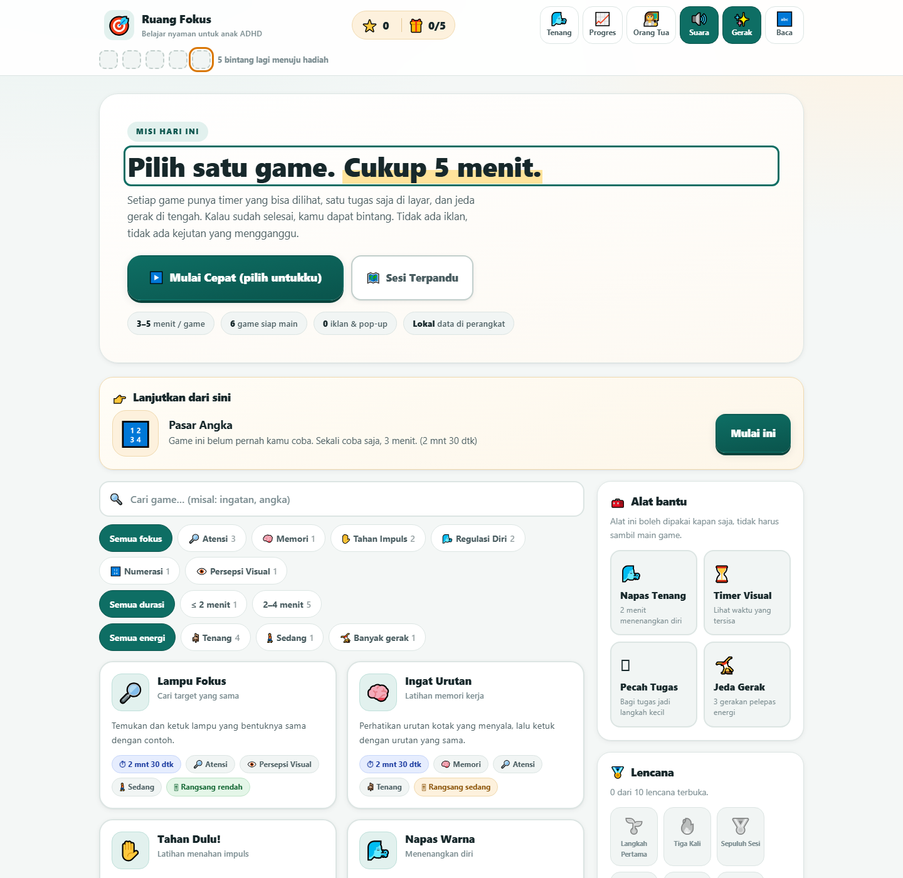
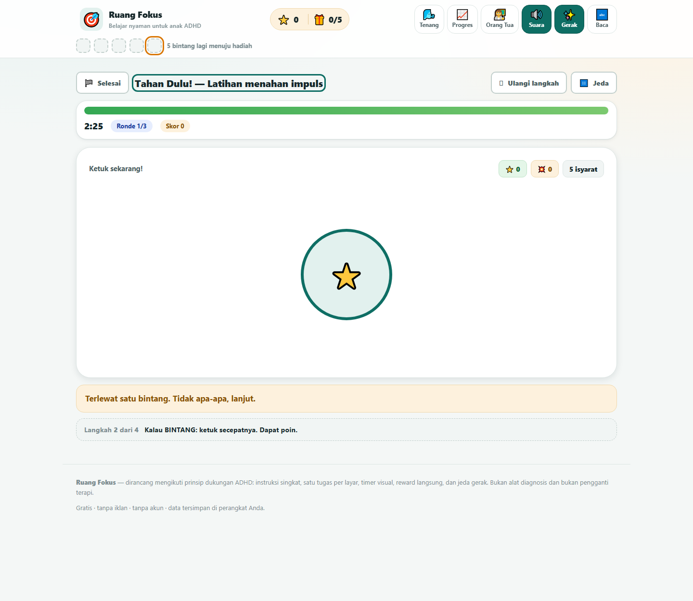
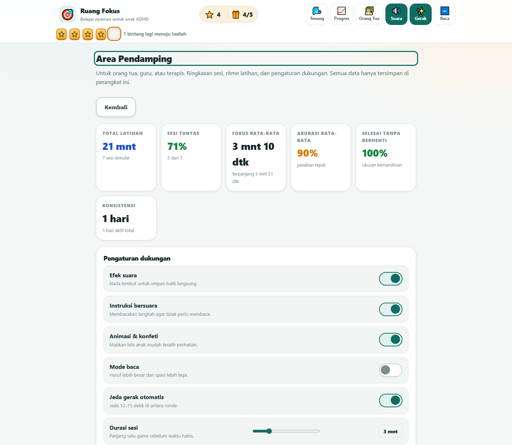

# Ruang Fokus

[](https://github.com/maxbootloop/ruang-fokus/actions/workflows/uji.yml)
[](https://github.com/maxbootloop/ruang-fokus/actions/workflows/pages.yml)
[](LICENSE)
[](#struktur-proyek)
[](#struktur-proyek)

Aplikasi web game belajar untuk **anak dengan ADHD** (Attention-Deficit/Hyperactivity Disorder).
Dibangun sebagai alternatif yang lebih ramah dari portal game edukasi umum, dengan fokus pada
**sesi pendek, satu tugas per layar, timer yang terlihat, umpan balik langsung, dan jeda gerak.**

Seluruh aplikasi berjalan di browser: **HTML + CSS + JavaScript murni, tanpa build step, tanpa server,
tanpa akun, tanpa iklan.** Semua data tersimpan di `localStorage` perangkat pengguna.



> **Ganti `maxbootloop`** di lencana dan tautan di atas dengan nama pengguna GitHub Anda setelah
> repositori dibuat. Cara tercepat: cari-ganti seluruh kata `maxbootloop` di berkas ini.
> Tautan di dalam aplikasi sendiri diatur dari **Area Pendamping → Tentang & GitHub**.

---

## Kenapa aplikasi ini dibuat

Aplikasi ini lahir dari analisis sebuah portal game edukasi populer
(`denigames.netlify.app`, yang sekarang mengalihkan ke `papaninteraktif.com` — katalog 33 game edukasi
untuk PAUD–SMA). Portal itu bagus sebagai **katalog**, tetapi desainnya berorientasi umum: durasi game
tidak diketahui di muka, tidak ada timer yang terlihat, tidak ada penyimpanan progres, dan tidak ada
penopang khusus untuk kesulitan eksekutif yang khas ADHD.

Analisis lengkap perbandingannya ada di **[docs/ANALISIS.md](docs/ANALISIS.md)**.

---

## Cara menjalankan

### 1. Paling cepat — langsung dari berkas

Buka `index.html` dengan peramban (klik dua kali). Cara ini bekerja, tetapi beberapa peramban membatasi
audio dan `localStorage` pada konteks `file://`.

### 2. Disarankan — lewat localhost

```bash
git clone https://github.com/maxbootloop/ruang-fokus.git
cd ruang-fokus
npm start           # sama dengan: node tools/serve.mjs 8137
# lalu buka http://127.0.0.1:8137/
```

Server statis kecil disertakan (`tools/serve.mjs`) supaya audio, `localStorage`, dan modul JavaScript
berjalan pada konteks yang aman. Tanpa `npm` pun bisa: `node tools/serve.mjs 8137`. Alternatif lain:

```powershell
python -m http.server 8137     # Python
npx serve -l 8137 .            # Node.js
```

> Membuka `index.html` langsung lewat `file://` umumnya tetap bekerja, tetapi beberapa browser membatasi
> audio dan penyimpanan pada konteks itu. Gunakan `localhost` untuk pengalaman penuh.

---

## Menerbitkan lewat GitHub

Aplikasi ini murni berkas statis, jadi GitHub Pages bisa langsung menyajikannya — gratis, tanpa server.

### Langkah pertama: unggah ke GitHub

Pilih salah satu cara di bawah.

#### Cara A — GitHub Desktop (paling mudah, tanpa baris perintah)

1. Buka **GitHub Desktop** → menu **File** → **Add local repository…** (atau `Ctrl+O`)
2. Pada **Local path**, pilih folder proyek ini (folder yang berisi `index.html`)
3. Klik **Add repository**
4. Klik tombol **Publish repository** di bagian atas
5. Isi **Name** = `ruang-fokus`, dan **hilangkan centang** *Keep this code private*
   (GitHub Pages gratis hanya berjalan pada repositori publik)
6. Klik **Publish repository**

Setelah selesai, repositori ada di `https://github.com/maxbootloop/ruang-fokus` dan komit lokal sudah
terunggah. Untuk perubahan berikutnya, cukup **Commit to main** lalu **Push origin** di GitHub Desktop.

#### Cara B — baris perintah

Repositori lokal sudah disiapkan (`git init`, branch `main`, komit pertama). Bila berkas `.git` belum
ada — misalnya karena Anda mengunduh proyek ini sebagai ZIP — jalankan dulu:

```bash
cd ruang-fokus
git init -b main
git add .
git commit -m "Ruang Fokus: game belajar singkat untuk anak ADHD"
```

Lalu buat repositori kosong bernama `ruang-fokus` di GitHub
(**tanpa** README, tanpa `.gitignore`, tanpa lisensi — semuanya sudah ada di sini), dan:

```bash
git remote add origin https://github.com/maxbootloop/ruang-fokus.git
git push -u origin main
```

Ganti `maxbootloop` dengan nama pengguna GitHub Anda. Bila `git` belum terpasang, unduh dari
[git-scm.com](https://git-scm.com/downloads) atau unggah folder lewat tombol **Add file → Upload files**
di halaman repositori.

> **Catatan Windows:** `.gitattributes` sudah menyetel normalisasi akhir baris, sehingga berkas tetap
> konsisten antara Windows dan runner Linux di GitHub Actions. Jangan hapus berkas itu.

### Langkah kedua: aktifkan GitHub Pages

1. Buka repositori → **Settings** → **Pages**
2. Pada **Source**, pilih **GitHub Actions**
3. Push apa pun ke `main`, atau jalankan manual dari tab **Actions** → **Terbitkan ke GitHub Pages** → **Run workflow**
4. Setelah selesai, situs aktif di `https://maxbootloop.github.io/ruang-fokus/`

Alur kerja di [.github/workflows/pages.yml](.github/workflows/pages.yml) sudah mengurus sisanya, dan
**menjalankan seluruh uji terlebih dahulu** sehingga situs tidak pernah terbit dalam keadaan rusak.

### Langkah ketiga: rapikan tautan

1. Ganti semua kata `maxbootloop` di berkas ini dengan nama pengguna Anda
2. Buka aplikasi → **Area Pendamping** (tahan 2 detik) → **Tentang & GitHub** → tempelkan alamat repositori

Setelah itu tautan GitHub di footer aplikasi dan di panel tersebut otomatis mengarah ke repositori Anda.

### Alternatif: Netlify / Vercel / Cloudflare Pages

Karena tanpa build step, cukup arahkan ke repositori dan biarkan **build command kosong** dengan
**publish directory** = akar repositori. Tidak ada konfigurasi lain yang diperlukan.

---

## Untuk siapa

| Peran | Manfaat |
|---|---|
| **Anak (7–12 tahun)** | Bermain game pendek yang bisa diselesaikan, mengumpulkan bintang, membuka lencana |
| **Orang tua** | Area Pendamping: ringkasan durasi fokus, kemandirian, akurasi, catatan pengamatan, pengaturan dukungan |
| **Guru / terapis** | Media latihan atensi, memori kerja, dan kontrol impuls; ekspor data JSON untuk dibawa ke konsultasi |

---

## Isi aplikasi

### 6 game yang bisa dimainkan

| Game | Latihan utama | Durasi | Energi | Rangsang |
|---|---|---|---|---|
| 🔎 **Lampu Fokus** | Atensi berkelanjutan & selektif, persepsi visual | 2 mnt 30 dtk | Sedang | Rendah |
| 🧠 **Ingat Urutan** | Memori kerja visual-spasial | 2 mnt 30 dtk | Tenang | Sedang |
| ✋ **Tahan Dulu!** | Kontrol impuls (Go–No-Go) | 2 mnt 30 dtk | Banyak gerak | Sedang |
| 🌬️ **Napas Warna** | Regulasi diri, pernapasan lambat | 2 mnt | Tenang | Rendah |
| 🔢 **Pasar Angka** | Numerasi (tambah/kurang sampai 20) | 2 mnt 30 dtk | Tenang | Rendah |
| ⏳ **Tenang Dulu** | Toleransi menunggu / menunda respons | 2 mnt 30 dtk | Tenang | Rendah |



### Alat bantu (bisa dipakai tanpa main game)

- 🌬️ **Napas Tenang** — lingkaran panduan napas, tanpa target dan tanpa penilaian
- ⏳ **Timer Visual** — 1/2/5/10/15 menit dengan cincin yang menyusut (melawan *time blindness*)
- 🪜 **Pecah Tugas** — memecah satu tugas besar menjadi langkah 5 menit, dengan template siap pakai
- 🤸 **Jeda Gerak** — 3 gerakan pelepas energi berdurasi 30 detik

### Sesi Terpandu

Satu tombol memulai rangkaian **3 game pendek** dengan **jeda gerak otomatis** di antaranya, lalu diakhiri
ringkasan sesi. Anak tidak perlu memilih atau mengingat urutan — mengurangi beban memori kerja dan
kesulitan memulai tugas (*task initiation*).

### Ekonomi token & lencana

- ⭐ Bintang diberikan karena **menyelesaikan** dan **tetap berusaha**, bukan karena skor sempurna
- Papan token visual 5 slot dengan **batas akhir yang jelas** (bukan skor tanpa ujung)
- 5 bintang dapat ditukar satu hadiah; orang tua bisa mengubah daftar hadiahnya
- 10 lencana yang menghargai **kebiasaan** (hari berurutan, jeda gerak, mencoba lagi setelah salah)

### Area Pendamping

Dilindungi gerakan "tahan 2 detik" agar anak tidak membukanya tanpa sengaja. Berisi ringkasan sesi,
grafik 7 hari, riwayat 30 sesi terakhir, pengaturan dukungan, catatan pengamatan, ekspor JSON,
cetak ringkasan, dan tombol hapus semua data.



---

## Prinsip desain ADHD yang dipakai

Ringkasan prinsip beserta rujukan buktinya ada di [docs/ANALISIS.md](docs/ANALISIS.md).
Yang paling menentukan bentuk aplikasi ini:

1. **Umpan balik segera.** Setiap jawaban benar/salah bersuara dan berwarna dalam milidetik pertama.
   Tidak ada penilaian yang ditunda sampai akhir.
2. **Sesi pendek dengan akhir yang terlihat.** Timer selalu tampil, termasuk saat anak sedang asyik.
3. **Satu tugas per layar.** Tidak ada menu samping, tidak ada iklan, tidak ada pop-up.
4. **Salah tidak dihukum.** Tidak ada pengurangan poin, tidak ada bunyi buzzer. Kesalahan dijawab dengan
   isyarat lembut, petunjuk, dan kadang ajakan menarik napas.
5. **Penopang memori kerja.** Kartu langkah sebelum bermain, tombol "Ulangi langkah" kapan saja,
   pengingat langkah permanen di bawah layar, dan dudukan eksternal berupa titik urutan.
6. **Jeda gerak terjadwal.** Disisipkan otomatis di antara ronde, bukan sebagai hukuman.
7. **Reward langsung dan konkret.** Bintang, konfeti lembut, dan papan token yang bisa dihitung dengan mata.
8. **Kendali di tangan anak.** Tombol "Selesai" selalu tersedia, dan berhenti di tengah tetap mendapat
   bintang serta ringkasan yang positif.
9. **Bisa disesuaikan.** Suara, instruksi bersuara, animasi, mode baca, durasi sesi, jumlah ronde, dan
   jeda gerak semuanya dapat diubah pendamping.
10. **Privasi sejak awal.** Tidak ada jaringan, tidak ada akun, tidak ada pelacakan. Data tidak pernah
    meninggalkan perangkat kecuali bila pendamping memilih mengekspornya.

---

## Aksesibilitas

- Target sentuh minimal **56 px** (tombol utama 72 px) — ramah untuk motorik yang belum matang
- Kontras teks memenuhi WCAG AA, warna latar lembut dan tidak menyilaukan
- Fokus keyboard selalu terlihat jelas (`:focus-visible` berukuran 3 px)
- **Mode baca**: huruf 16% lebih besar, spasi kata dan baris lebih lega
- **Mode kurangi gerakan**: menghormati `prefers-reduced-motion` dan bisa dimatikan manual
- Semua layar dapat dicapai dengan keyboard; `Esc` untuk keluar, `Space`/`Enter` untuk aksi utama
- Struktur semantik dengan `aria-live` untuk umpan balik, `role="switch"` untuk pengaturan, dan
  `aria-pressed` untuk tombol sakelar
- Tersedia gaya cetak untuk ringkasan Area Pendamping

---

## Struktur proyek

```
adhd-games/
├── index.html          # seluruh layar: beranda, kartu langkah, panggung game,
│                       # jeda gerak, pojok tenang, timer, pecah tugas, progres,
│                       # area pendamping, ringkasan sesi, overlay, toast
├── styles.css          # sistem desain ADHD: target sentuh besar, kontras, mode baca,
│                       # mode kurangi gerakan, tata letak responsif, gaya cetak
├── app.js              # katalog & filter game, navigasi, sesi terpandu, ekonomi token,
│                       # progres, area pendamping, alat bantu
├── js/
│   ├── core/
│   │   ├── store.js    # state + localStorage, token, lencana, statistik, catatan, ekspor
│   │   ├── audio.js    # efek suara Web Audio + instruksi bersuara (Web Speech)
│   │   ├── ui.js       # helper DOM, toast, overlay, konfeti lembut, utilitas
│   │   └── session.js  # mesin sesi: timer akurat, ronde, jeda, API host untuk game
│   └── games/
│       ├── attention.js    # Lampu Fokus
│       ├── memory.js       # Ingat Urutan
│       ├── inhibition.js   # Tahan Dulu!
│       ├── breathe.js      # Napas Warna
│       ├── math.js         # Pasar Angka
│       └── calm.js         # Tenang Dulu + alat Napas Tenang
├── tools/
│   ├── serve.mjs       # server statis untuk pengujian lokal
│   └── smoke.mjs       # harness uji: DOM tiruan, menjalankan semua game & alur
├── docs/
│   ├── ANALISIS.md     # analisis denigames.netlify.app + dasar desain ADHD
│   ├── referensi-katalog-papaninteraktif.json
│   └── shots/          # tangkapan layar
├── .github/workflows/
│   ├── uji.yml         # periksa sintaks + jalankan uji pada setiap push/PR
│   └── pages.yml       # terbitkan ke GitHub Pages setelah uji lulus
├── package.json        # skrip npm: start, test, check (tanpa dependensi)
├── LICENSE             # MIT + catatan bukan alat medis
├── .gitignore          # termasuk pola data ekspor anak agar tidak ter-commit
├── .gitattributes      # normalisasi akhir baris LF lintas Windows/Linux
└── README.md
```

---

## Pengujian

```bash
npm test              # sama dengan: node tools/smoke.mjs
npm run check         # periksa sintaks semua berkas JavaScript
```

Harness ini menjalankan aplikasi di Node dengan DOM tiruan, lalu memverifikasi **142 pemeriksaan**:

- inisialisasi, katalog, filter, lencana, papan token
- **keenam game dimainkan sampai selesai**, termasuk lewat jeda gerak antar ronde
- ekonomi token dan penukaran hadiah
- sesi terpandu tiga game dari awal sampai ringkasan
- alat bantu (napas, timer, pecah tugas, jeda gerak)
- progres, area pendamping, catatan, ekspor data
- ketahanan: sesi pasif tanpa interaksi tetap berakhir tepat waktu, anak berhenti di tengah,
  jeda & lanjut, penghapusan data, filter kosong
- pengaturan dan mode aksesibilitas
- tautan GitHub: normalisasi alamat, penolakan alamat asing, sinkronisasi ke footer
- **nol galat runtime** sepanjang seluruh alur

Beberapa bug nyata ditemukan dan diperbaiki lewat harness ini — lihat bagian catatan di
[docs/ANALISIS.md](docs/ANALISIS.md).

Pintasan verifikasi manual (untuk tangkapan layar):

```
http://127.0.0.1:8137/#game=tahan-dulu       # langsung buka satu game
http://127.0.0.1:8137/#screen=grownup&seed=1 # area pendamping dengan data contoh
http://127.0.0.1:8137/#screen=progress&seed=1
```

---

## Batasan penting

- Aplikasi ini **bukan alat diagnosis** dan **bukan pengganti terapi, obat, atau pendampingan
  profesional.** Ia adalah media latihan dan penopang belajar.
- Game di sini **bukan program terapi teruji klinis.** Prinsip desainnya mengikuti rekomendasi umum
  untuk anak ADHD (sesi pendek, umpan balik langsung, penopang memori kerja, jeda gerak), tetapi
  manfaatnya bersifat latihan, bukan pengobatan.
- Efek latihan kognitif terhadap gejala ADHD masih diperdebatkan dalam literatur. Yang paling konsisten
  bermanfaat adalah **dukungan lingkungan, struktur, dan regulasi diri** — itulah yang ditonjolkan
  aplikasi ini.
- **Data tersimpan per perangkat dan per browser.** Tidak ada sinkronisasi antar perangkat. Menghapus
  data browser akan menghapus riwayat.
- Instruksi bersuara bergantung pada suara bahasa Indonesia yang tersedia di sistem operasi.

---

## Lisensi & kredit

Kode Ruang Fokus dirilis di bawah **[Lisensi MIT](LICENSE)** — bebas dipakai, diubah, dan dibagikan,
termasuk untuk keperluan komersial, dengan tetap menyertakan pemberitahuan hak cipta.

Berkas [LICENSE](LICENSE) juga memuat catatan penting: perangkat lunak ini **bukan alat diagnosis medis
dan bukan pengganti terapi.**

### Kredit

Analisis pembanding dalam [docs/ANALISIS.md](docs/ANALISIS.md) berbasis halaman publik
`papaninteraktif.com` (sebelumnya `denigames.netlify.app`), katalog game edukasi karya
**Deni Ranoptri, M.Pd**.

**Tidak ada kode, aset, gambar, atau konten dari situs tersebut yang disalin.** Yang diambil hanya
pelajaran desain dari bentuk luarnya (katalog game dengan kartu detail berisi langkah bermain dan
manfaat). Seluruh game, tata letak, dan kode di repositori ini ditulis dari awal.

### Berkontribusi

Kontribusi sangat diterima, terutama:

- **Uji kebergunaan bersama anak ADHD dan pendampingnya** — ini validasi yang paling berharga
- Penambahan game baru yang mengikuti kerangka di `js/games/` (lihat pola `mount/pause/resume/unmount`
  dan API `host` di `js/core/session.js`)
- Perbaikan aksesibilitas dan terjemahan antarmuka

Sebelum mengirim pull request:

```bash
npm run check     # sintaks
npm test          # 142 pemeriksaan harus lulus
```

Setiap pull request otomatis diuji oleh
[.github/workflows/uji.yml](.github/workflows/uji.yml).

### Melaporkan masalah

Gunakan tab **Issues** di repositori. Untuk masalah yang menyangkut anak, mohon **jangan sertakan data
pribadi** — ekspor data dari Area Pendamping memuat riwayat sesi dan sebaiknya tidak ditempelkan ke
issue publik.
